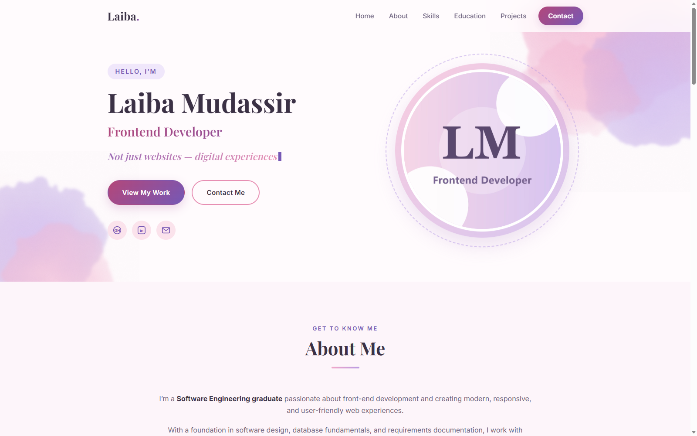
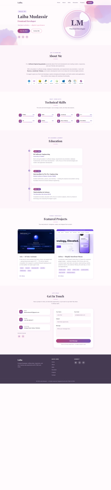
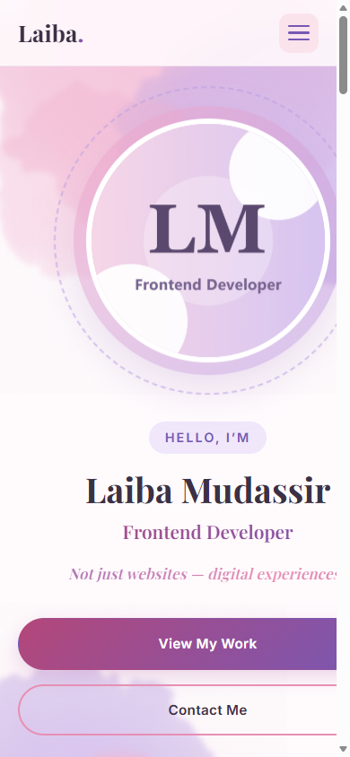

# Laiba Mudassir — Personal Portfolio

A modern, professional, and fully responsive personal portfolio website. The site showcases my profile, technical skills, education, featured projects, and contact information through an elegant white, blush-pink, and lilac watercolor interface.

---

## 📖 Project Description

This is a personal portfolio website, created to showcase my profile, technical skills, educational background, and projects in a professional and organized way.

The entire website is designed and styled with **hand-written HTML5 and CSS3**. No CSS frameworks (Bootstrap, Tailwind, etc.), no UI kits, and no downloaded templates were used — every layout, color, and animation in this project was coded from scratch.

The visual identity is built around a soft **watercolor theme**: a white canvas with flowing pink and lilac washes, elegant serif headings, and smooth micro-animations that feel polished without being distracting.

---

## 🛠️ Technologies Used

| Technology | Purpose |
|------------|---------|
| **HTML5** | Semantic page structure, forms, media, accessibility attributes |
| **CSS3** | Custom design system, Flexbox & Grid layouts, animations, media queries |
| **SVG** | Hand-crafted watercolor decoration filters and inline icons |
| **Google Fonts** *(optional)* | Playfair Display + Inter typography (graceful system-font fallback) |

---

## ✨ Website Features

### Sections
- **Home / Hero** — name, professional tagline, an animated **rewriting punch line** (a typewriter that types *"Not just websites — digital experiences"*, deletes it, and rewrites *"Clean, responsive, intuitive."*), profile image, and call-to-action buttons
- **About** — a polished three-paragraph introduction, centered under the heading, plus a strip of ten tech-stack icons (C++, C#, JavaScript, Python, Tailwind, Node.js, Visual Studio, GitHub, MySQL, Antigravity)
- **Skills** — eight compact skill cards with custom SVG icons, percentages, and animated progress meters (HTML5 95%, CSS3 92%, JavaScript 85%, C++ 100%, C# 80%, Python 50%, React/Node.js 80%, Git & GitHub 80%)
- **Education** — academic timeline: BS Software Engineering at the University of Sialkot (2022–2026), FSc Pre-Engineering at NIMS (2021–2022), and Matriculation at The Education City School
- **Projects** — three consistent, compact project cards — ***Aria — AI Voice Assistant*** (Python · Streamlit · ElevenLabs API), ***Zelvox — Shopify Storefront Theme*** (Shopify Liquid · OS 2.0 · vanilla JS), and ***ProjectSync — FYP Portal*** (React 18 · TypeScript · Firebase · Docker) — each with a real product screenshot, an equal-length description, matching technology tags, and a GitHub link
- **Contact** — email, phone, location, social links, and a fully styled (UI-only) contact form
- **Footer** — copyright, quick navigation links, and social icons


## 📁 Project Structure

```text
Personal Portfolio/
│
├── index.html              
├── style.css              
├── README.md
│
├── images/
│   ├── profile.jpg                     
│   ├── project1.png                    
│   ├── project2.png                    
│   ├── project3.png                    
│   ├── watercolor-blob-1.svg         
│   ├── watercolor-blob-2.svg         
│   │
│   └── screenshots/
│       ├── desktop-hero.png          
│       ├── desktop-full.png           
│       └── mobile-hero.png            
│
└── tools/
    ├── generate-images.ps1            
    └── screenshot-mobile.html          
```

---

## 📸 Screenshots

### Desktop — Hero


### Desktop — Full Page


### Mobile


---

## 🚀 How to Run the Website

The site is fully static — no build step or dependencies required.

### Option 1 — Open directly
1. Download or clone this folder.
2. Double-click **`index.html`**. It opens in any modern browser (Chrome, Edge, Firefox, Safari).

### Option 2 — Local server 
```bash
# From the project folder, run any static server, for example:
python -m http.server 8000
# then open http://localhost:8000 in your browser
```


*Designed & built with hand-written HTML5 and CSS3 — © 2026 Laiba Mudassir.*
